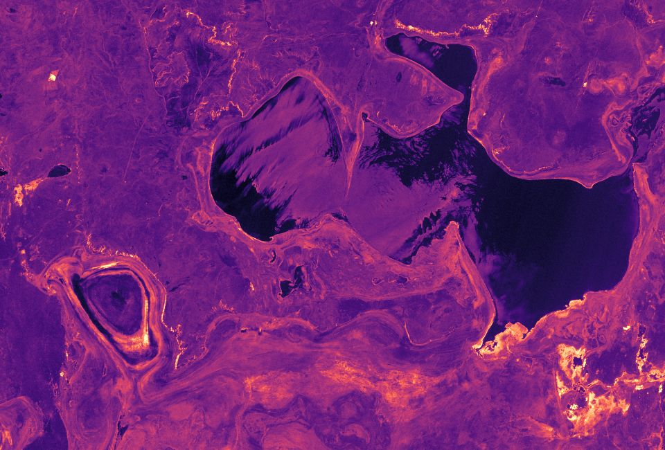
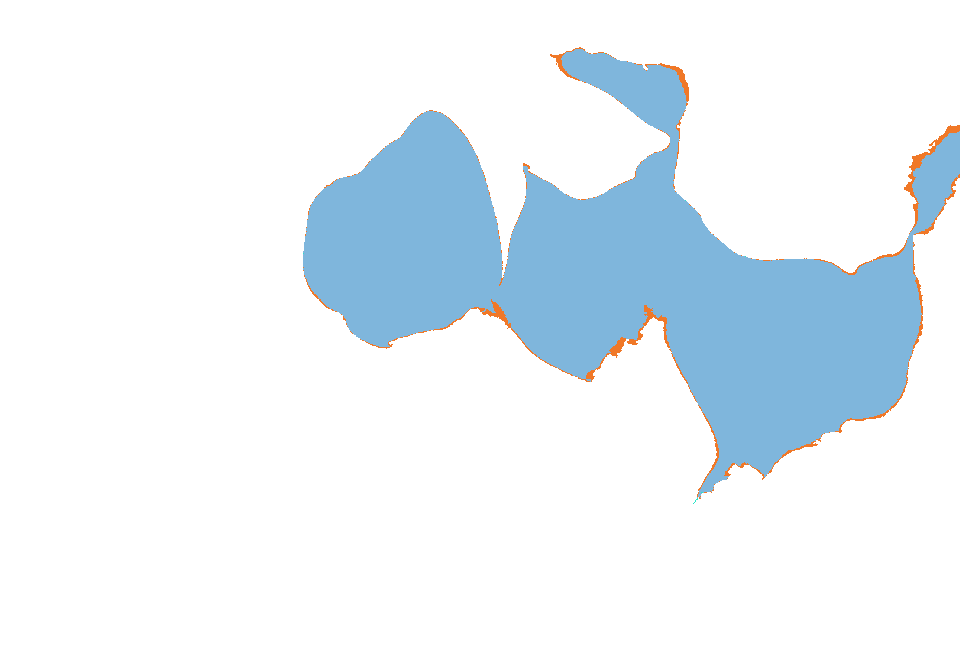

# Tracing the Aral Sea

**[Explore the deployed interactive atlas →](https://javen420.github.io/Tracing-the-aral-sea/website/)**

A static, no-build website that presents our June–October 2026 mapping of open water in the North Aral Sea using NISAR radar observations.

## Preview

<p align="center">
  
  
</p>
<p align="center"><sub>Radar brightness on 21 June (left); mapped water change from late June to October (right).</sub></p>

## Explore the atlas

The page is organized into interactive plates:

| Plate | What you can explore |
|---|---|
| 00 · Overview | A nine-pass radar time-lapse and changing water-area estimate |
| 01 · History | A timeline of the Aral Sea's retreat and restoration efforts |
| 02 · Radar method | A guided explanation of how paired radar observations help map water |
| 03 · Quiz | Identify water and land in a radar image, then check the answer key |
| 04 · Threshold lab | Adjust the coherence cut-off and see how the mapped area changes |
| 05 · Satellite check | Compare the radar map with Sentinel-2 optical imagery |
| 06 · North Aral | Review the nine-window area trend, uncertainty range, and evidence ledger |
| 07 · Evidence | Read the validation results, method, data, and references |

## Run locally

The site has no build step or npm dependencies. For all features—including the threshold lab—serve the `website` folder with a local web server. Opening `index.html` directly may prevent the lab from reading image pixels because browsers restrict that access for `file://` pages.

From the repository root, run one of these commands:

**Windows PowerShell**

```powershell
cd website
py -m http.server 8000
```

**macOS or Linux**

```sh
cd website
python3 -m http.server 8000
```

Then open [http://localhost:8000](http://localhost:8000). Leave the terminal running while you use the site; press `Ctrl+C` to stop the server.

## Project files

```text
website/
├── index.html       Page structure and copy
├── css/styles.css   Layout, typography, and colors
├── js/              Plain JavaScript scripts that share window.ARAL
├── data/            Water boundaries, area measurements, and validation tables
└── img/             Radar, coherence, water, change, optical, and history images
```

The scripts load in order from `index.html`; `utils.js` provides shared helpers and `data.js` contains the display data and image paths. Analysis images are produced by project scripts in `tools/`; historical images are credited on the page. If you rerun the analysis, review the displayed values in `js/data.js` as well.

The site uses Fraunces, Source Sans 3, and IBM Plex Mono from Google Fonts. Reduced-motion preferences are respected.
